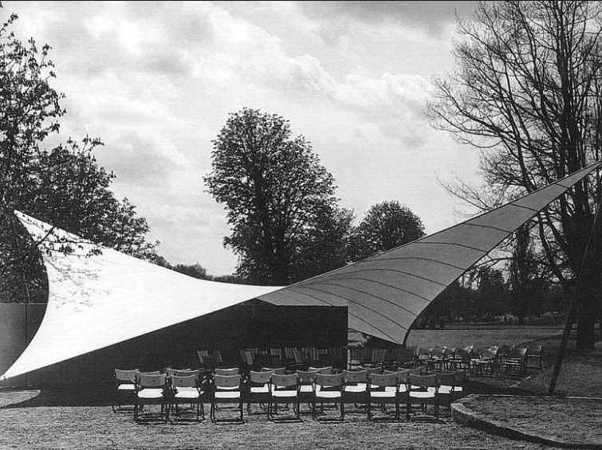
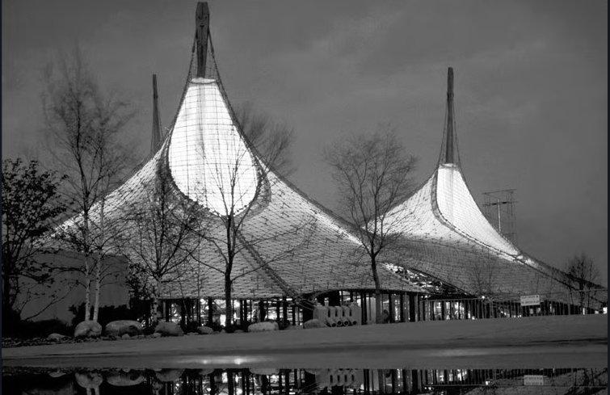
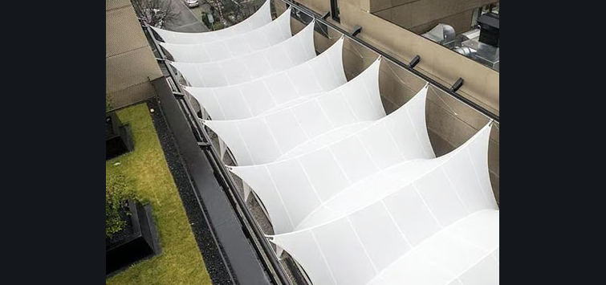
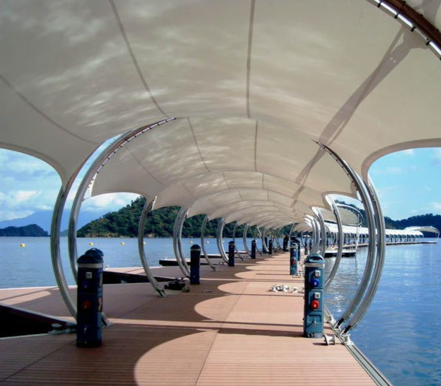
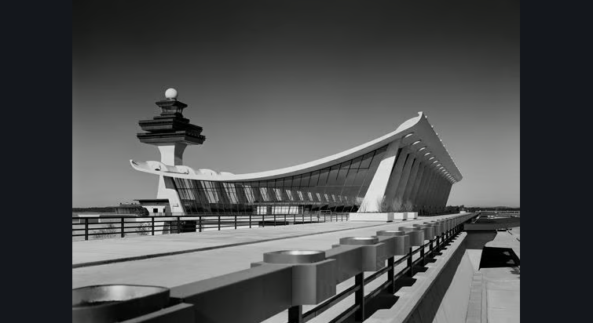
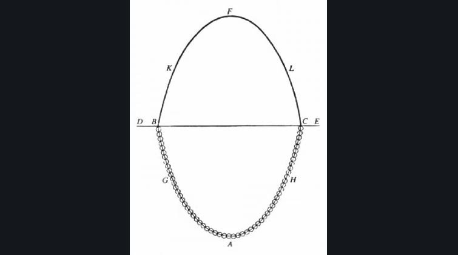
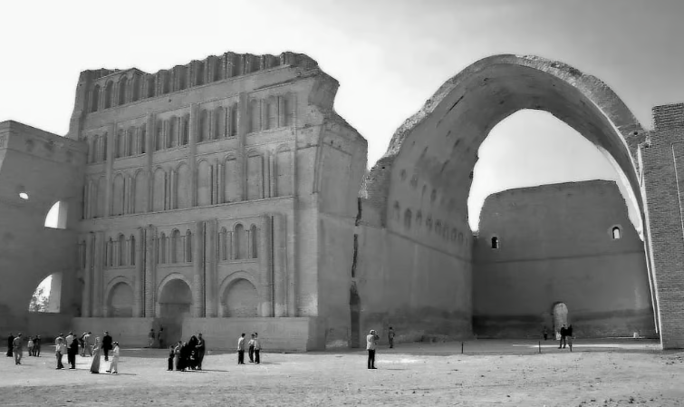
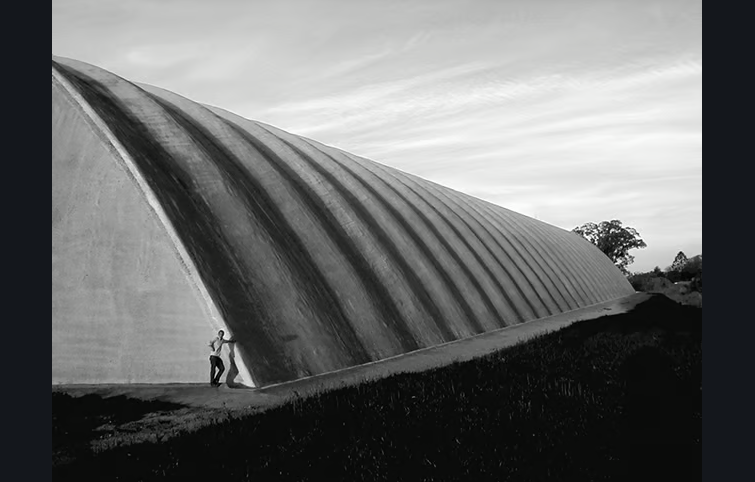
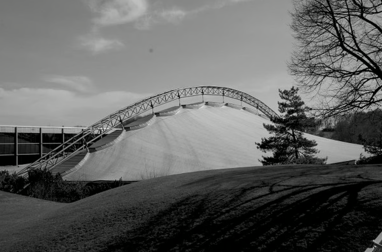
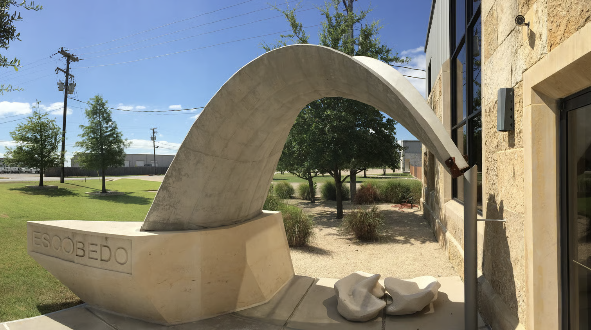

References

- Adriaenssens, S., Block, P., Veenendaal, D. & Williams, C. (Eds.) (2014). *Shell Structures for Architecture: Form Finding and Optimization*. Routledge. doi:10.4324/9781315849270
- Linkwitz, K. (2014). Force density method: design of a timber shell. In *Shell Structures for Architecture* (pp. 59-70). Routledge.
- Schek, H.-J. (1974). The force density method for form finding and computation of general networks. *CMAME* 3, 115-134. doi:10.1016/0045-7825(74)90045-0
- Linkwitz, K. & Schek, H.-J. (1971). Einige Bemerkungen zur Berechnung von vorgespannten Seilnetzkonstruktionen. *Ingenieur-Archiv* 40(3), 145-158.
- Gründig, L., Moncrieff, E., Singer, P. & Ströbel, D. (2000). A history of the principal developments and applications of the force density method in Germany 1970-1999. *Proc. IASS-IACM 2000*, Chania-Crete.
- Linkwitz, K., Gründig, L., Bahndorf, J., Neureither, M. & Ströbel, D. (1988). Optimizing the shape of the roof of the Olympic Stadium, Montreal. *Structural Engineering Review* 1, 225-232.
- Moncrieff, E., Gründig, L. & Ströbel, D. (1999). The cutting pattern generation of the Pilgrim's Tents for Phase II of the Mina Valley Project. *Proc. IASS 40th Anniversary Congress*, Madrid.
- Rippmann, M. (2012). *Funicular Shell Design*. PhD thesis, ETH Zürich.

Historical precedents from COMPAS FormFinder

The local images below come from the linked COMPAS FormFinder manual pages and correspond to the supplied PDF; each image has a direct relative link so it can be opened from the Markdown file.

## Hypar membrane

- Frei Otto, Bundesgartenschau Kassel, 1955, an early mechanically prestressed membrane; image credited to Atelier Frei Otto in the manual. [Python example](10_compas/03_hypar_membrane.md), [manual source, PDF pages 38-39](https://github.com/BlockResearchGroup/compas-FoFin/blob/main/gitbook/examples-basic/tensile-form-active/mechanically-prestressed/hypar.md), [open image](04_references/bundesgartenschau_kassel_1955.png).

## Conical membrane with a light eye

- Frei Otto and Rolf Gutbrod, German Pavilion, World Expo Montreal, 1967, with eye-shaped conical membranes. [Python example](10_compas/04_conical.md), [manual source, PDF pages 47-48](https://github.com/BlockResearchGroup/compas-FoFin/blob/main/gitbook/examples-basic/tensile-form-active/mechanically-prestressed/conical.md), [open image](04_references/german_pavilion_world_expo_montreal_1967.png).

## Ridge and valley wave and convertible wave

- Convertible membrane roofing at Metzgergasse, Buchs, 2014, a built ridge and valley wave. [Wave example](10_compas/05_wave.md), [convertible example](10_compas/11_convertible_wave.md), [manual source, PDF page 64](https://github.com/BlockResearchGroup/compas-FoFin/blob/main/gitbook/examples-basic/tensile-form-active/mechanically-prestressed/wave.md), [open image](04_references/convertible_membrane_roofing_metzgergasse_buchs_2014.png).

## Arch supported membrane

- Arch supported membranes at Poruklu Marina, 2009. [Python example](10_compas/06_arch_supported.md), [manual source, PDF page 71](https://github.com/BlockResearchGroup/compas-FoFin/blob/main/gitbook/examples-basic/tensile-form-active/mechanically-prestressed/arch-supported.md), [open image](04_references/poruklu_marina_arch_supported_membranes_2009.png).

## Catenary cables

- Eero Saarinen, Washington Dulles International Airport, 1962, whose suspended roof illustrates the funicular cable principle. [Python example](10_compas/07_catenary_cables.md), [manual source, PDF page 85](https://github.com/BlockResearchGroup/compas-FoFin/blob/main/gitbook/examples-basic/tensile-form-active/funicular/catenary-cables.md), [open image](04_references/washington_dulles_international_airport_1962.png).

## Catenary arch with corrugations

- Giovanni Poleni, drawing of Hooke's analogy between an arch and a hanging chain, 1748, reproduced in the catenary cables and corrugated arch manual pages. [Python example](10_compas/08_corrugated_arch.md), [manual source, PDF page 96](https://github.com/BlockResearchGroup/compas-FoFin/blob/main/gitbook/examples-basic/compressive-form-active/catenary-arch-with-corrugations.md), [open image](04_references/poleni_hooke_arch_and_hanging_chain_analogy_1748.png).

- Taq Kasra, the Arch of Ctesiphon, Iraq, circa 540, an ancient funicular masonry arch whose exact construction date is debated. [Python example](10_compas/08_corrugated_arch.md), [manual source, PDF page 97](https://github.com/BlockResearchGroup/compas-FoFin/blob/main/gitbook/examples-basic/compressive-form-active/catenary-arch-with-corrugations.md), [dating reference](https://royalsocietypublishing.org/rsnr/article/77/1/113/66025/New-historical-records-about-the-construction-of), [open image](04_references/taq_kasra_ctesiphon_arch_iraq_circa_540.png).

- Eladio Dieste, Navíos Corporation Silos, Nueva Palmira, 1997, a corrugated funicular barrel vault used as a stiffening scheme. [Python example](10_compas/08_corrugated_arch.md), [manual source, PDF page 97](https://github.com/BlockResearchGroup/compas-FoFin/blob/main/gitbook/examples-basic/compressive-form-active/catenary-arch-with-corrugations.md), [open image](04_references/navios_corporation_silos_nueva_palmira_1997.png).

## Vault with lips

- Heinz Isler, Paradies Tennis Centre in Allschwil, 1982, a funicular concrete shell developed through physical form finding. [Python example](10_compas/09_vault_with_lips.md), [manual source, PDF page 102](https://github.com/BlockResearchGroup/compas-FoFin/blob/main/gitbook/examples-basic/compressive-form-active/vault-with-lips.md), [open image](04_references/paradies_tennis_centre_allschwil_1982.png).

## Compressive arch supported net

- Ackermann und Partner and Schlaich Bergermann Partner, Munich Ice Ring Roof, 1967, a prestressed cable net with compressive arch support. [Python example](10_compas/10_compressive_arch.md), [manual source, PDF page 114](https://github.com/BlockResearchGroup/compas-FoFin/blob/main/gitbook/examples-basic/mixed-form-active/compressive-arch-supported.md), [open image](04_references/munich_ice_ring_roof_1967.png).

## Curve constrained net

- Block Research Group and Escobedo Construction, cable-net and fabric formed thin shell, Buda, Texas, 2014. [Python example](10_compas/12_curve_constraints.md), [project reference](https://block.arch.ethz.ch/brg/project/cable-net-fabric-formed-thin-shell-buda-tx-usa), [manual source, PDF page 127](https://github.com/BlockResearchGroup/compas-FoFin/blob/main/gitbook/examples-advanced/curve-constraints-geometry-generation.md), [open image](04_references/cable_net_fabric_formed_thin_shell_buda_texas_2014.png).

